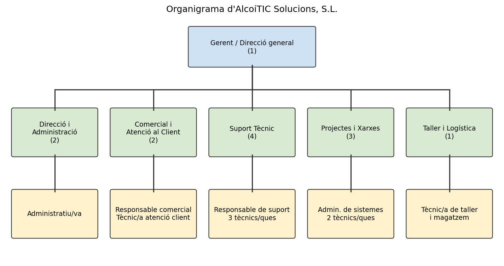

# 2. Departaments i estructura organitzativa

AlcoiTIC Solucions té una estructura senzilla i funcional de **12 treballadors** repartits en cinc departaments.

## 2.1 Departaments, funcions i personal

| Departament | Nre. treballadors | Funcions i responsabilitats |
|---|---|---|
| **Direcció i Administració** | 2 | Direcció general, estratègia, finances, comptabilitat, facturació, contractes, recursos humans i gestió administrativa |
| **Comercial i Atenció al Client** | 2 | Captació i seguiment de clients, elaboració d'ofertes, gestió de contractes de manteniment i atenció telefònica i per correu |
| **Suport Tècnic** | 4 | Atenció d'incidències (remot i presencial), manteniment preventiu i correctiu, gestió de tiquets i suport a usuaris |
| **Projectes i Xarxes** | 3 | Disseny i instal·lació de xarxes i servidors, migracions, còpies de seguretat, seguretat i administració de sistemes |
| **Taller i Logística** | 1 | Reparació i muntatge d'equips, gestió de magatzem, recepció i lliurament de material |
| **Total** | **12** | |

## 2.2 Llocs de treball i funcions principals

| Lloc de treball | Departament | Quantitat | Funcions principals |
|---|---|---|---|
| Gerent / Director/a general | Direcció i Administració | 1 | Decisions estratègiques, relació amb proveïdors i finances |
| Administratiu/va | Direcció i Administració | 1 | Facturació, comptabilitat, tràmits i atenció administrativa |
| Responsable comercial | Comercial i Atenció al Client | 1 | Estratègia comercial, ofertes i grans clients |
| Tècnic/a d'atenció al client | Comercial i Atenció al Client | 1 | Recepció de peticions, registre de tiquets i seguiment |
| Responsable de suport | Suport Tècnic | 1 | Coordinació de l'equip i escalat d'incidències |
| Tècnic/a de suport | Suport Tècnic | 3 | Resolució d'incidències, visites als clients i manteniment preventiu |
| Administrador/a de sistemes i xarxes | Projectes i Xarxes | 1 | Servidors, xarxes, seguretat i còpies; responsable tècnic dels projectes |
| Tècnic/a de xarxes i sistemes | Projectes i Xarxes | 2 | Instal·lació, cablejat, configuració d'equips i servidors |
| Tècnic/a de taller i magatzem | Taller i Logística | 1 | Reparacions, muntatge d'equips i control de l'estoc |

## 2.3 Organigrama

