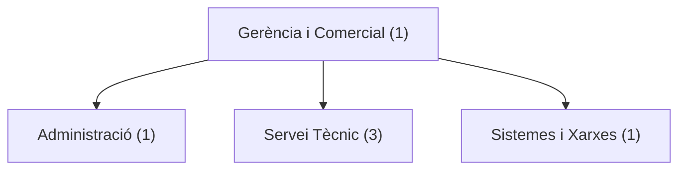

# 02 - Organització de l'empresa

## 1. Estructura organitzativa

WiFiFix té una estructura organitzativa senzilla, adaptada a una microempresa de 6 treballadors.

L'empresa està dividida en quatre departaments.

## 2. Departaments i funcions

| Departament | Treballadors | Funcions principals |
|---|---:|---|
| Direcció i comercial | 1 | Gestió general, clients i vendes |
| Administració | 1 | Factures, comptabilitat i documentació |
| Servei tècnic | 3 | Instal·lacions, reparacions i manteniment |
| Sistemes i xarxes | 1 | Administració de servidors, xarxes i seguretat |
| **Total** | **6** | |

## 3. Llocs de treball

### Gerent i responsable comercial

S'encarrega de dirigir l'empresa, gestionar els pressupostos, buscar nous clients i organitzar el treball.

### Administratiu

Gestiona les factures, els cobraments, els pagaments, les cites amb els clients i la documentació de l'empresa.

### Tècnics informàtics

Els tres tècnics realitzen instal·lacions de xarxes Wi-Fi, reparacions d'ordinadors i manteniment dels equips dels clients.

### Administrador de sistemes i xarxes

S'encarrega de configurar servidors, gestionar les xarxes internes, realitzar còpies de seguretat i supervisar la seguretat informàtica.

També dona suport als tècnics quan apareixen incidències complexes.

## 4. Organigrama

L'organigrama mostra la jerarquia de WiFiFix.

## 5. Coordinació entre departaments

Els departaments treballen de manera coordinada.

Quan arriba una sol·licitud d'un client, el gerent prepara el pressupost i organitza el servei.

El departament tècnic realitza la instal·lació o reparació. Si es necessita una configuració avançada, intervé el responsable de sistemes i xarxes.

Finalment, administració registra el servei i gestiona la facturació.

Aquesta organització permet oferir una atenció eficient sense necessitat de tindre una estructura excessivament complexa.
