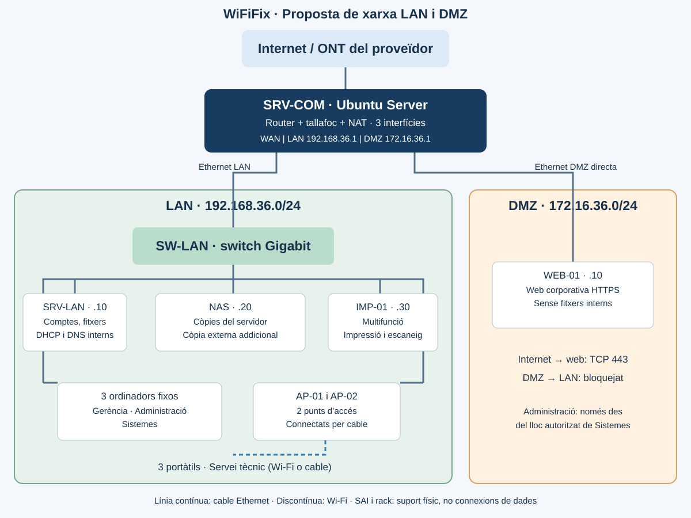

# Bloc 2 · 03 - Disseny de la xarxa

## 1. Topologia proposada

[Obrir el diagrama complet](../../../img/xarxa-wififix.svg). Les línies contínues representen Ethernet i la discontínua representa Wi-Fi. Els enllaços dibuixats per grup simplifiquen el diagrama: cada equip cablejat té el seu propi port de switch.

Proposem una topologia en estrella en la LAN, amb un switch central. El servidor de comunicacions connecta tres zones separades: WAN, LAN i DMZ. Seguim la [proposta local amb xarxa mixta](02-alternatives-viabilitat.md). És un disseny pendent d'implantació i proves.

## 2. Components i funcions

| Component | Quantitat | Funció i connexió |
|---|---:|---|
| ONT/equip del proveïdor | 1 | Entrada d'Internet. Preferim lliurament directe o mode pont cap a WAN quan el proveïdor ho permeta |
| SRV-COM | 1 | Ubuntu Server dedicat a encaminament, tallafoc amb UFW/netfilter i NAT, amb tres interfícies: WAN, LAN i DMZ. Fa la funció del router amb firewall previst al Bloc 1; no és un segon router de l'empresa |
| SW-LAN | 1 | Switch Gigabit de 16 ports. Connecta clients fixos, servidor intern, NAS, impressora, AP i interfície LAN de SRV-COM |
| SRV-LAN | 1 | Servidor intern per a comptes, permisos i fitxers, amb DHCP i DNS interns. La selecció del sistema i serveis es concretarà en recursos |
| NAS | 1 | Destinació de còpies dels documents i configuracions. Cal afegir una còpia fora del local i comprovar restauracions |
| WEB-01 | 1 | Servidor dedicat a la web corporativa, connectat directament a la interfície DMZ de SRV-COM |
| Ordinadors fixos | 3 | Un de gerència, un d'administració i un de sistemes; connectats per Ethernet |
| Portàtils | 3 | Servei tècnic. Wi-Fi al local i possibilitat de connectar-los per cable |
| AP-01 i AP-02 | 2 | Punts d'accés connectats per cable al switch; quantitat prevista, pendent de cobertura i alimentació PoE/injectors |
| Impressora multifunció | 1 | Ethernet a la LAN; impressió i escaneig segons permisos |
| SAI i rack | 1 de cada | Protecció elèctrica i ordenació. No són nodes de transmissió; la càrrega i autonomia es calcularan en recursos |

Hi ha sis equips d'usuari per a sis treballadors. Els servidors no són treballadors ni clients addicionals. El servidor intern, el servidor de comunicacions i el servidor web tenen funcions diferents. SRV-COM i WEB-01 concreten necessitats del Bloc 2 que s'han d'incorporar al document 05 i al pressupost 06. No es pressuposa que estiguen comprats ni que càpiguen en la reserva parcial anterior.

La proposta de referència els representa com equips dedicats per a deixar clara la separació. Una futura alternativa virtualitzada haurà de justificar host, recursos, interfícies i xarxes virtuals aïllades; no es connectarà la mateixa màquina directament a LAN i DMZ per comoditat.

## 3. Connexions i capacitat

1. Proveïdor → WAN de SRV-COM.
2. LAN de SRV-COM → SW-LAN.
3. SW-LAN → tres fixos, SRV-LAN, NAS, impressora i dos AP, cadascun amb el seu cable.
4. Els tres portàtils utilitzen els AP o preses del switch. No augmenta el nombre de clients si canvien de mitjà.
5. DMZ de SRV-COM → WEB-01, per un cable dedicat. No cal un segon switch per a un únic servidor en DMZ.

Ocupació màxima prevista de SW-LAN: 1 passarel·la + 3 fixos + 1 servidor + 1 NAS + 1 impressora + 2 AP + 3 portàtils per cable = **12 ports**. Un switch de 16 deixa 4 ports de marge. Els AP poden requerir PoE o injectors compatibles; cal incloure'ls una sola vegada en pressupost.

Si l'equip del proveïdor ha de fer de router, caldrà documentar el doble NAT i els reenviaments. Per a publicar la web en producció cal verificar IP pública accessible, absència de CGNAT o una alternativa d'allotjament, DNS públic i certificat HTTPS. En laboratori es poden simular WAN i accés extern amb xarxes de VirtualBox; això no publica la web en Internet real.

## 4. LAN i DMZ

| Zona | Xarxa proposada | Passarel·la | Contingut |
|---|---|---|---|
| LAN | 192.168.36.0/24 | 192.168.36.1 | Sis clients, SRV-LAN, NAS, impressora i dos AP |
| DMZ | 172.16.36.0/24 | 172.16.36.1 | WEB-01 |
| WAN | Segons el proveïdor o laboratori | Segons el proveïdor o NAT del laboratori | Connexió externa de SRV-COM |

Les dos subxarxes internes no se solapen. El número 36 s'utilitza com identificador acadèmic del projecte; no és una exigència tècnica. Les IP de servidor .10, NAS .20 i impressora .30 del diagrama són reserves proposades. El pla complet, noms, clients, AP i rang DHCP es desenvoluparan en el document 04, sense usar adreces reservades per DHCP com IP fixes.

En DMZ només proposem la web corporativa HTTPS. No exposem fitxers SMB, NAS, comptes interns, escriptori remot ni consoles d'administració. Si la web és compromesa, la separació i el tallafoc han de limitar el moviment cap a la LAN; una subxarxa diferent sense regles no és suficient. La gestió de la web es farà des del lloc autoritzat de sistemes.

## 5. Política d'accés proposada

El tallafoc serà amb estat: les respostes a connexions autoritzades es permeten; la resta del trànsit nou entre zones es denega per defecte. NAT no substituïx les regles de filtratge.

| Origen → destinació | Accés proposat | Motiu |
|---|---|---|
| Internet → WEB-01 | TCP 443 amb DNAT i regla explícita | Publicar només HTTPS. TCP 80 només si es justifica per redirecció o validació del certificat |
| Internet → LAN | Denegat | No exposar serveis interns |
| DMZ → LAN | Connexions noves denegades | Aïllar la web dels comptes i documents |
| Lloc autoritzat de sistemes → WEB-01 | TCP 22 i 443 | Administrar i comprovar la web; sense accés general des de tots els clients |
| LAN → DMZ | TCP 443; altres ports denegats excepte gestió anterior | Consultar la web |
| LAN → Internet | HTTP/HTTPS per navegació i actualitzacions; DNS via servidor intern i NTP segons configuració | Eixida necessària amb NAT i regles explícites |
| WEB-01 → Internet | HTTP/HTTPS per actualitzacions, DNS a resolutor extern autoritzat i NTP necessari | Mantindre la web sense obrir accés cap a la LAN |
| Sistemes → SRV-COM | SSH des del lloc de sistemes, via LAN | Administració restringida del tallafoc |

El servidor DNS intern utilitzarà un reenviador extern autoritzat; no serà un resolutor públic obert. DHCP només servirà la LAN. Les regles entre zones no controlen per si soles les comunicacions entre equips del mateix switch: calen permisos dels serveis i tallafocs dels hosts. La política IPv6 també s'haurà de definir i comprovar, sense deixar un camí sense filtrar.

## 6. Decisions i proves pendents

El cable connecta la infraestructura i els llocs fixos; el Wi-Fi dona mobilitat. No afegim xarxa de convidats en esta proposta mínima. Si es necessita, s'haurà de dissenyar una zona o VLAN separada i pressupostar la compatibilitat. La Wi-Fi corporativa requerirà xifrat i credencials adequades.

En la implantació comprovarem: connexió dels sis clients; resolució DNS; accés a fitxers amb un usuari autoritzat i denegació amb un altre; restauració d'un fitxer; web accessible des d'una xarxa externa simulada; denegació d'una connexió iniciada en DMZ cap a LAN; accés administratiu només des de sistemes; i cobertura dels dos AP. Són proves previstes, no resultats obtinguts.

## 7. Fonts tècniques

Consulta: 2 de novembre de 2026. La topologia i les regles són una proposta pròpia basada en les necessitats; no copiem sense revisar les regles d'un exemple extern.

- [Ubuntu: tallafoc i UFW](https://documentation.ubuntu.com/security/security-features/network/firewall/): funció del filtratge.
- [Ubuntu: UFW framework](https://manpages.ubuntu.com/manpages/jammy/man8/ufw-framework.8.html): encaminament i masquerading. Caldrà verificar la sintaxi en la versió final instal·lada.
- [Netgate: DMZ i adreçament encaminat](https://docs.netgate.com/pfsense/en/latest/recipes/route-public-ip-addresses.html): referència de separació i filtratge, encara que la nostra proposta utilitza Ubuntu.
- [Cisco: xarxes cablejades i sense fils](https://www.cisco.com/site/us/en/learn/topics/small-business/wireless-network.html).
- [Enunciat PI-Q.2.1](https://aules.edu.gva.es/fp/mod/assign/view.php?id=11792927), [necessitats](01-necessitats.md) i [alternatives](02-alternatives-viabilitat.md).
