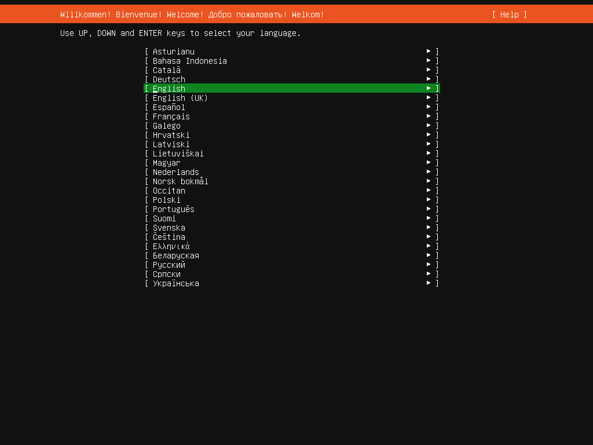
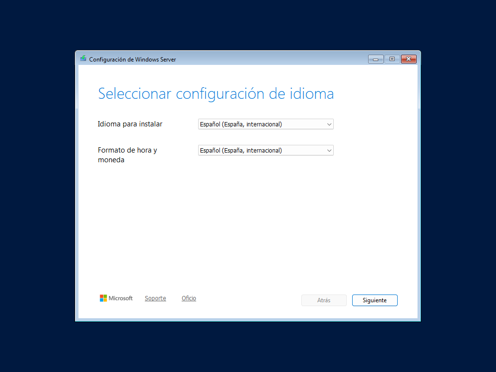
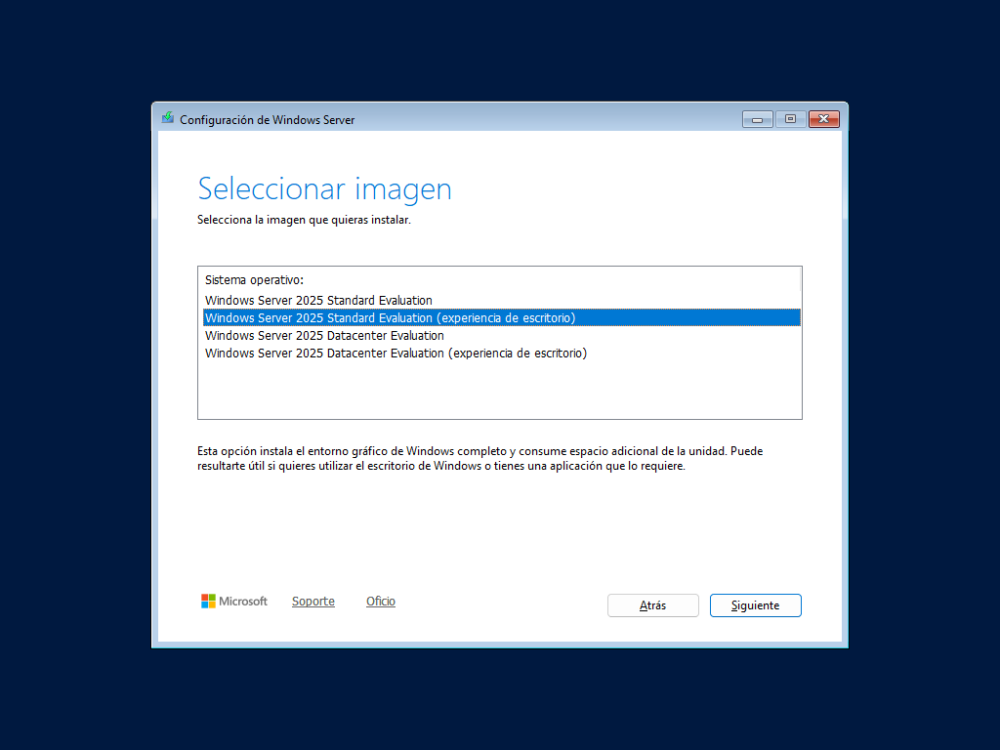
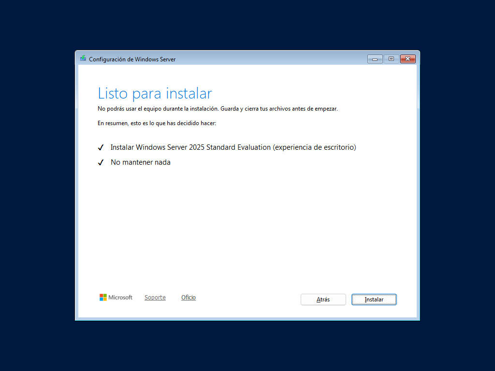
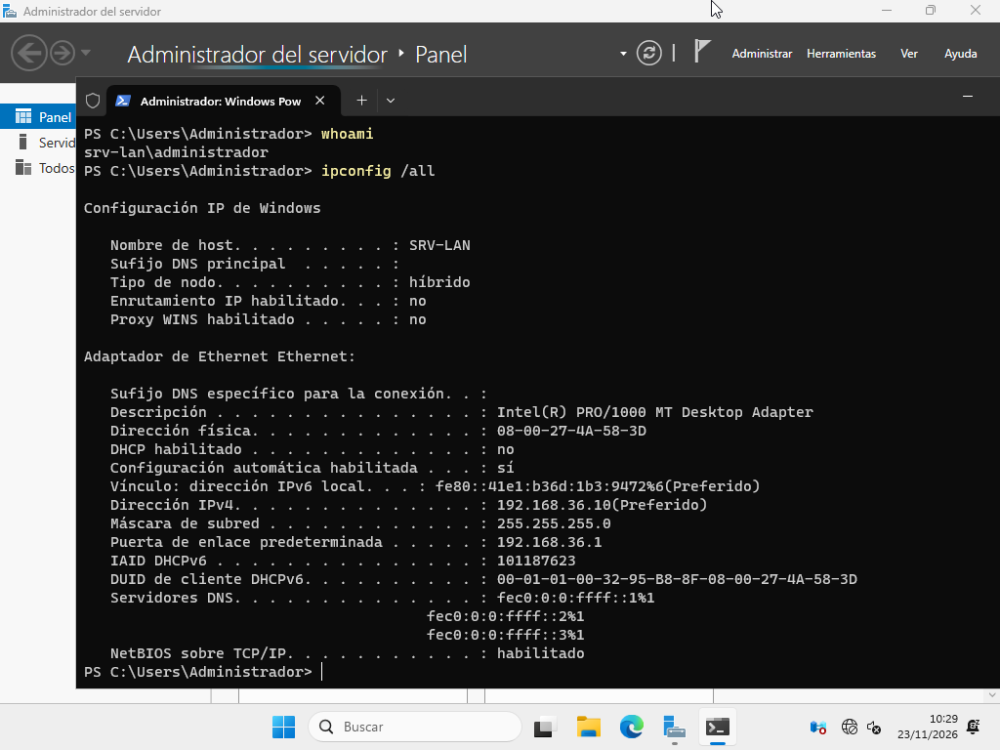
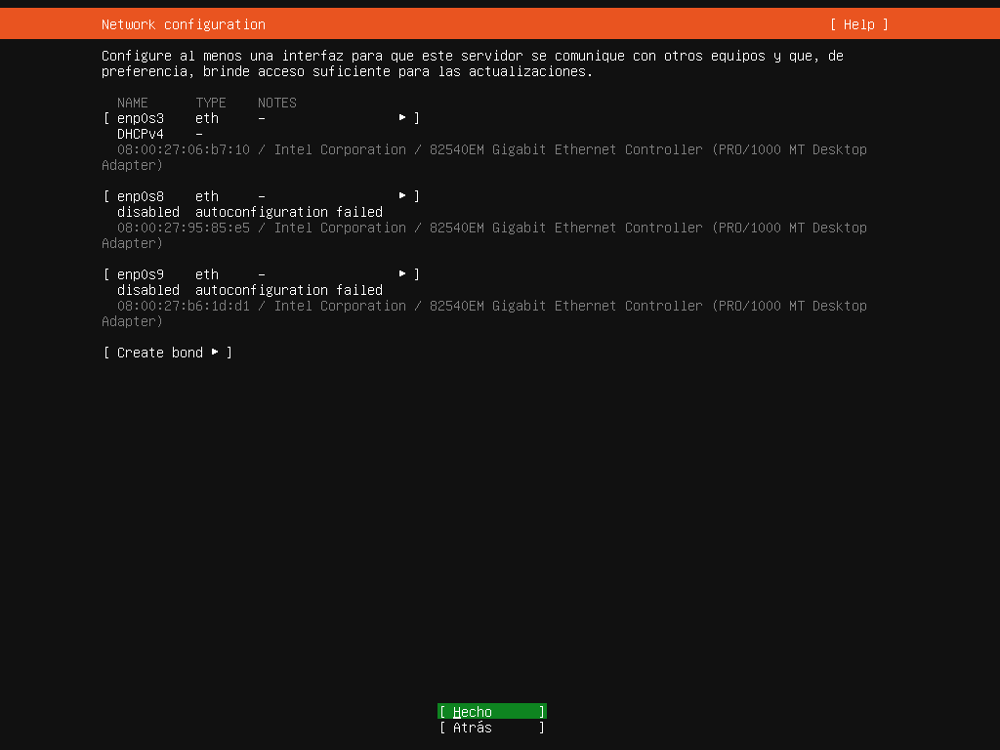
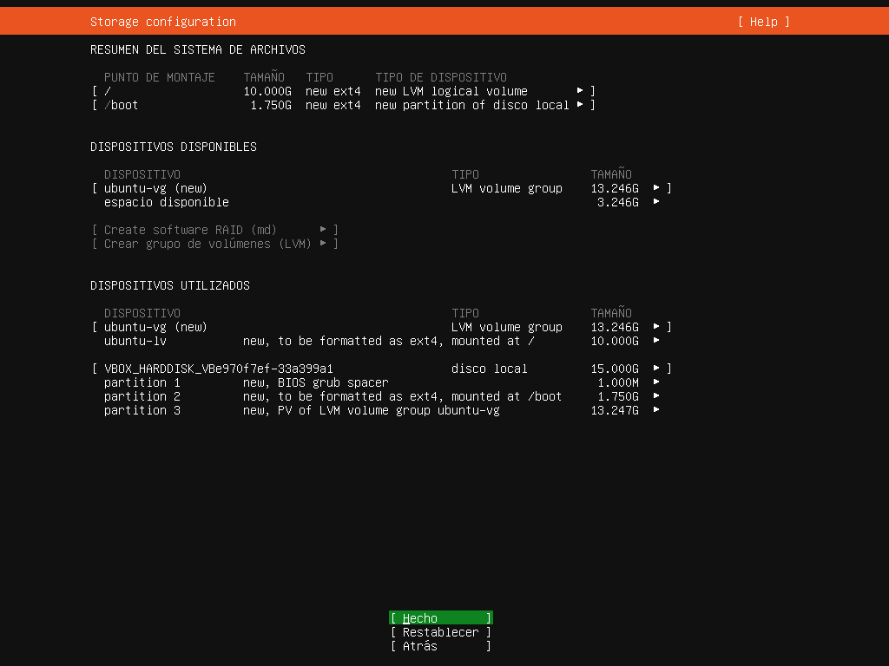
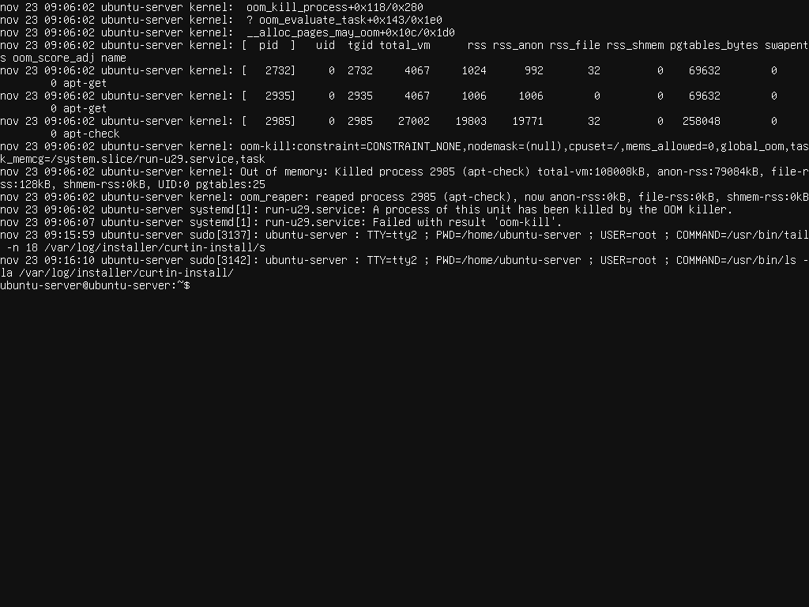
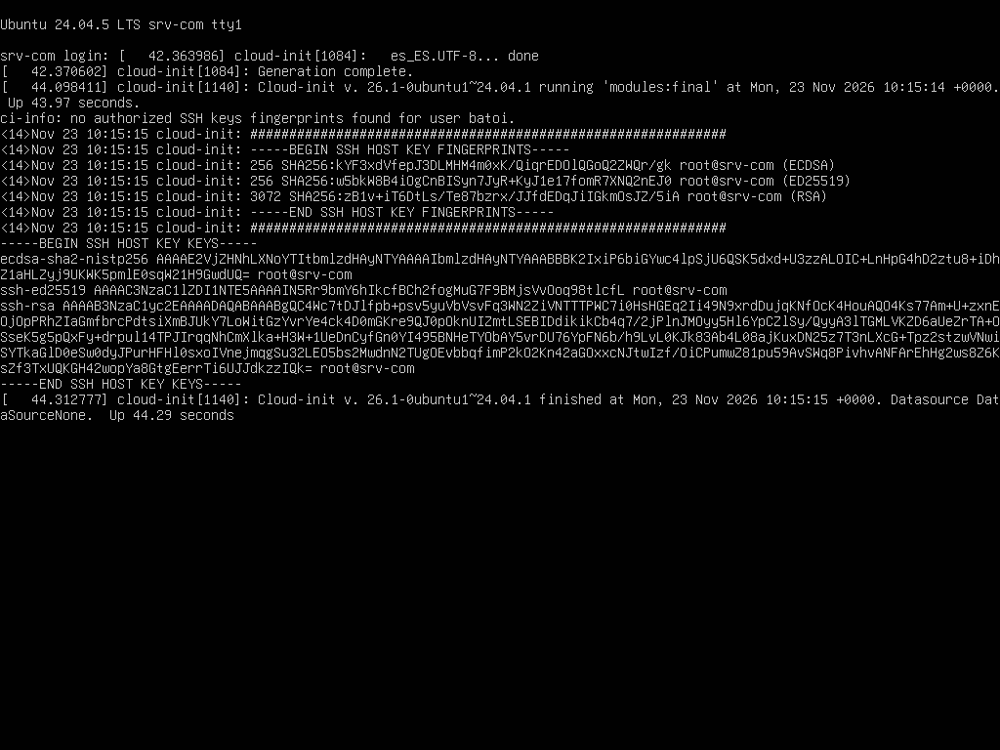

# 02 · Màquines virtuals

Les cinc VMs s'han creat en VirtualBox 7.2.16 al PC de Ferran amb discos VDI dinàmics. La instal·lació i la transferència al PC comú es registraran segons el treball de cada membre.

| VM | Funció | Sistema previst | RAM | vCPU | Disc | Estat |
|---|---|---|---:|---:|---:|---|
| SRV-COM | Encaminament i Kea | Ubuntu Server 24.04.5 LTS | 2 GiB (temporal) | 1 | 15 GiB | Instal·lat; arrenca fins al login (sessió pendent de validar) |
| SRV-LAN | Servidor intern | Windows Server 2025 Standard Evaluation (experiència d'escriptori) | 3 GiB | 2 | 50 GiB | Instal·lat i amb sessió iniciada (vegeu avall) |
| PC-ADM | Client d'administració | Windows 11 25H2 | 4 GiB | 2 | 64 GiB | ISO muntada, EFI i TPM 2.0 |
| PT-TEC01 | Client tècnic | Linux Mint 22.3 Cinnamon | 2 GiB | 2 | 25 GiB | ISO muntada |
| WEB-01 | Servidor de la DMZ | Ubuntu Server 24.04.5 LTS | 1 GiB | 1 | 15 GiB | ISO muntada |

S'han verificat set MAC virtuals diferents. Cal capturar una sessió iniciada en cada SO amb `hostname` i `whoami`. SRV-LAN es prepara amb IP fixa. L'Active Directory correspon al Sprint 3.

*Arrancada del suport d'instal·lació de SRV-COM.*

## Actualització 23/11/2026

La ISO de Windows Server 2025 està a `/home/batoi/winserv25.iso` i muntada a SRV-LAN. La màquina està creada amb 3 GiB RAM, 2 vCPU i disc virtual de 50 GiB, connectada a `wififix-lan`. La VM s'ha agrupat a `/WiFiFix Sprint 2`. S'ha intentat iniciar l'instal·lador, però després de «Loading files…» la consola ha quedat negra. Per tant, Windows Server encara no està instal·lat ni s'ha validat l'inici de sessió.

*Pantalla negra observada després de carregar els fitxers d'instal·lació.*

### Instal·lació de SRV-LAN (23/11/2026)

La pantalla negra posterior a «Loading files…» no era un error de configuració: la ISO té 8 GB i l'instal·lador tardava a mostrar l'assistent. La VM manté BIOS, arrencada DVD → disc, controladora SATA i xarxa interna `wififix-lan`. Decisions de l'assistent: idioma i teclat Español, edició **Standard Evaluation (experiència d'escriptori)** (admet gestió gràfica i serveix per al Sprint 3), disc de 50 GB buit amb particions automàtiques. No s'instal·la Active Directory en aquest sprint.

*Edició escollida a l'assistent de SRV-LAN.*

*Resum de l'assistent abans de copiar fitxers; l'inici de sessió encara no està validat.*

**Resultat verificat a SRV-LAN:** instal·lat Windows Server 2025 Standard Evaluation (experiència d'escriptori), sessió iniciada com a `administrador`. Es reanomena el sistema a `SRV-LAN` (era `WIN-0KVFPQAB8H9`) i se li assigna la IP fixa del pla: `192.168.36.10/24`, passarel·la `192.168.36.1`, DHCP desactivat i una sola targeta a `wififix-lan` (MAC `08-00-27-4A-58-3D`). Sense Active Directory ni domini (Sprint 3).

*SRV-LAN amb nom `SRV-LAN`, usuari `srv-lan\administrador` i IP `192.168.36.10`, després del reinici.*

### Instal·lació de SRV-COM (23/11/2026)

La ISO d'Ubuntu Server 24.04.5 no estava muntada i s'ha muntat des de `Descargas`. L'instal·lador detecta les tres interfícies (`enp0s3` NAT amb DHCP, `enp0s8` i `enp0s9` en xarxes internes) i es fa servir el disc de 15 GB amb LVM (`/` 10 GB, `/boot` 1,75 GB). Les IP fixes es configuren després de la instal·lació.

*Les tres interfícies de SRV-COM vistes per l'instal·lador.*

*Esquema de particions proposat per a SRV-COM.*

Nota de recursos: l'instal·lador d'Ubuntu Server va fallar dues vegades amb només 1 GiB de RAM perquè el nucli va matar `apt-check` per falta de memòria. Per instal·lar-lo, SRV-COM s'ha pujat temporalment a 2 GiB (vegeu 07).

*Evidència de l'OOM killer a l'instal·lador d'SRV-COM.*

**Resultat a SRV-COM:** la instal·lació ha acabat sense errors amb 2 GiB. Després d'expulsar la ISO, el sistema arrenca i mostra `srv-com login:`, amb el nom `srv-com`, OpenSSH instal·lat i cap clau SSH autoritzada. Encara falta iniciar sessió i capturar `hostname` i `whoami`, configurar les tres interfícies amb netplan i decidir si es torna a 1 GiB o es deixa en 2 GiB.

*SRV-COM arrencat després de la instal·lació; el login encara no s'ha validat.*
