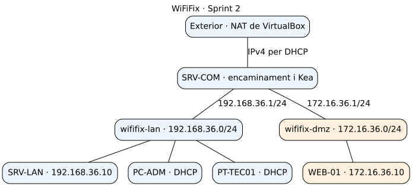

# 03 · LAN, DMZ i adreçament

S'han assignat els adaptadors a VirtualBox. Les IP de la taula corresponen a l'adreçament previst dins dels sistemes, pendent de validar.

| Equip | Adaptador / MAC | Xarxa / mode | IPv4 | Prefix | Passarel·la | DNS |
|---|---|---|---|---|---|---|
| SRV-COM | 1 / 08:00:27:06:B7:10 | Exterior / NAT | DHCP del NAT, habitualment 10.0.2.15 | /24 habitual | 10.0.2.2 habitual | DHCP del NAT |
| SRV-COM | 2 / 08:00:27:95:85:E5 | wififix-lan / interna | 192.168.36.1 | /24 | — | — |
| SRV-COM | 3 / 08:00:27:B6:1D:D1 | wififix-dmz / interna | 172.16.36.1 | /24 | — | — |
| SRV-LAN | 1 / 08:00:27:4A:58:3D | wififix-lan / interna | 192.168.36.10 | /24 | 192.168.36.1 | — |
| PC-ADM | 1 / 08:00:27:82:B4:41 | wififix-lan / interna | Kea, 192.168.36.100–149 | /24 | 192.168.36.1 | — |
| PT-TEC01 | 1 / 08:00:27:22:A2:72 | wififix-lan / interna | Kea, 192.168.36.100–149 | /24 | 192.168.36.1 | — |
| WEB-01 | 1 / 08:00:27:7C:14:79 | wififix-dmz / interna | 172.16.36.10 | /24 | 172.16.36.1 | — |

La ruta per defecte de SRV-COM l'establirà el DHCP de l'exterior. A WEB-01, configureu l'adreça i la ruta per defecte amb Netplan. A SRV-LAN, configureu l'IPv4 de l'adaptador Ethernet i reinicieu després d'assignar el nom. L'IPv4 dels clients ha de quedar en mode automàtic. [Configuració de xarxa en Ubuntu Server](https://ubuntu.com/server/docs/configuring-networks/)

*Topologia dels adaptadors creats i adreçament previst.*
