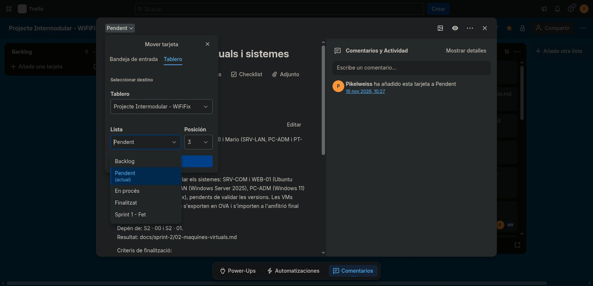

# 07 · Seguiment i incidències

[Tauler de Trello de WiFiFix](https://trello.com/b/AtTTwzrK/projecte-intermodular-wififix)

| Data | Previsió | Treball verificat | Temps lectiu | Pendent |
|---|---|---|---|---|
| 23/11/2026 | Preparar amfitrió i començar les VMs | Cinc VMs registrades, set MAC diferents i dues xarxes internes assignades. Arrancada dels instal·ladors de SRV-COM i SRV-LAN; SRV-LAN instal·lat amb nom i IP fixa verificats; SRV-COM instal·lant | Pendent de registrar per l'equip | Instal·lació i validació dels SO, configuració, DHCP i proves |

| Data | Equip o tasca | Problema o desviació | Causa identificada | Intervenció i responsable | Comprovació final | Comunicació al professorat |
|---|---|---|---|---|---|---|
| 23/11/2026 | SRV-LAN | ISO pendent | El pla indica Server 2025 i es va identificar una ISO de Server 2022 | S'ha localitzat `winserv25.iso` (Server 2025 Evaluation) i s'ha muntat a SRV-LAN | ISO de Server 2025 muntada; l'assistent l'accepta | No cal |
| 23/11/2026 | SRV-LAN | Pantalla negra després de «Loading files…» | No era un error: la ISO d'8 GB tardava a carregar l'assistent | Ferran: es revisa la configuració d'arrencada (correcta) i s'espera la càrrega | L'assistent apareix i la instal·lació avança | No cal |
| 23/11/2026 | SRV-COM | Instal·lador d'Ubuntu falla dues vegades a «configuring apt» | El registre del nucli mostra l'OOM killer matant `apt-check`: 1 GiB de RAM és insuficient per a l'instal·lador | Ferran: pujar SRV-COM a 2 GiB temporalment i repetir la instal·lació | Amb 2 GiB passa aquest pas; instal·lació en curs | No cal de moment |
| 23/11/2026 | SRV-COM | ISO no muntada i arrencada per disquet | La VM s'havia creat sense suport d'instal·lació | Ferran: muntar la ISO d'Ubuntu Server 24.04.5 i posar el DVD com a primer dispositiu | L'instal·lador arrenca | No cal |

La LAN i la DMZ de VirtualBox ja estan assignades segons la SA1. Queda pendent verificar les IP dins dels sistemes, el reenviament, les concessions i la connectivitat. Les aportacions efectives de Ferran i Mario i la captura final de Trello es registraran quan es complete el laboratori.

*Estat intermedi del tauler el 23/11/2026.*
